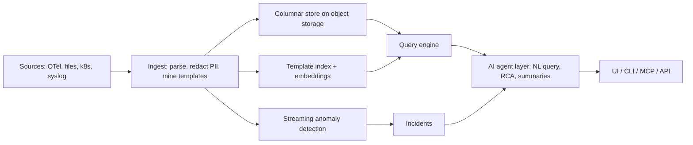

# aigolog — AI-Native Log Analysis System: Design Characteristics

> Goal: a log analysis system that beats ELK/OpenSearch, Loki, Graylog, Splunk, Datadog,
> Sumo Logic and cloud-native logging by being **AI-native**: AI shapes the data model,
> not just a chatbot layered on top.

Incumbents (Splunk, Datadog, Elastic, Grafana) have already added AI assistants to
their existing systems, so a chat UI alone will not beat them. The advantage has to come
from the architecture.

---

## Core Design Characteristics

### 1. Logs stored as patterns, not raw text
- At ingest, group every line into a **template plus parameters**. For example,
  `User {id} failed login from {ip}`, using template-mining algorithms like Drain combined with ML.
- **Compression:** storing each template once and only the values per line often shrinks data 10–50×.
- **Search and anomaly detection:** both run on a few thousand templates instead of billions of lines.
- **AI cost:** the AI reasons over summaries of patterns, never over every raw line.

### 2. Accept any format without setup
- Read any format without regex parsers or a predefined schema: JSON, logfmt, plain text,
  stack traces that span several lines.
- Use OpenTelemetry natively, but also take syslog, files, Kubernetes and cloud log streams.
- A small model guesses field types and names (`latency_ms`, `trace_id`, `user_email`).

### 3. Cheap, scalable storage
- Store data in columns, in Parquet-style files on object storage (S3 or compatible).
- Keep storage and compute separate, with hot, warm and cold tiers.
- Aim for Loki-level cost or lower, with search as fast as Elastic.

### 4. Plain-language questions plus a real query language
- "Why did checkout fail after 14:00?" becomes a generated query that the user can see and edit.
- Keep a proper query language as well, piped or SQL-like, for power users and repeatable use.
- Add similarity search: "show me logs like this one", based on embeddings of the templates.

### 5. An AI investigator
- It runs queries itself, step by step, until it finds the cause.
- It connects logs with metrics, traces, deploys, config changes and git commits.
- Output is a root-cause hypothesis plus a timeline, with **citations to the actual log lines**.
- It can link an error back to the line of source code that produced it, and suggest a fix or open a PR.

### 6. Problems found without writing alert rules
- Detect brand-new templates, sudden changes in how often a pattern appears,
  and new values that break a known pattern.
- Learn normal patterns per service, including daily and weekly cycles.
- Group related alerts into one incident to cut alert noise.

### 7. Layered AI to control cost

| Layer | Technique | Runs on |
|---|---|---|
| Hot path (every line) | Template matching, statistics, PII redaction | Plain code, no models |
| Warm (per template or time window) | Small models: classification, anomaly scoring, embeddings | Local CPU or GPU |
| On demand | LLM reasoning, summaries, agent investigations | Local or cloud, user's choice |

**Rule:** never send every log line through an LLM. That one decision is what keeps it affordable.

### 8. Trustworthy answers
- Every AI claim is backed by queries the user can run and log lines they can check.
- Show confidence levels, and fall back to plain logic when the model is unsure.
- Learn from feedback: when engineers mark something as "real incident" or "noise", the system adjusts.

### 9. Privacy and security first
- Remove personal data (PII) and secrets at ingest, before anything is stored or sent to a model.
- **Bring your own model:** fully local (Ollama or vLLM) for regulated or air-gapped environments,
  or OpenAI, Anthropic or Gemini.
- Support multiple tenants, role-based access control (RBAC) and audit logs, including a log of AI actions.

### 10. Easy for developers and agents to use
- An **MCP server**, so coding agents (Claude Code, Cursor and similar) can query production logs
  directly. This is where most incumbents are still weak.
- A single binary that works on a laptop and scales out to a cluster. Go fits this well.
- Usable from the command line first, with a web UI, and the AI should handle most of the configuration.

---

## Rough Architecture

---

## Where You Can Actually Win

1. **Cost:** template compression plus cheap object storage, versus Splunk and Datadog pricing.
2. **Self-hosted AI:** local models with no data leaving the company, which SaaS vendors can't offer.
3. **Agent-native:** MCP and code-aware root-cause analysis, so the logs feed into the developer's workflow.

---

## Suggested First Version

Build a Go single binary that:

- takes OTel and file logs
- mines templates and stores them in Parquet
- detects new or spiking templates
- answers plain-language questions through a local LLM, citing the log lines it used
- exposes an MCP server

That is enough to show the core advantages before you build out scale.

---

## Open Decisions

- Target users: startups/SMBs, enterprises, or individual developers?
- Distribution: self-hosted open source, SaaS, or both?
- Default LLM: local-first (Ollama/vLLM) or cloud-first?
- Storage engine: build on ClickHouse/DuckDB/Parquet, or a custom columnar store?
